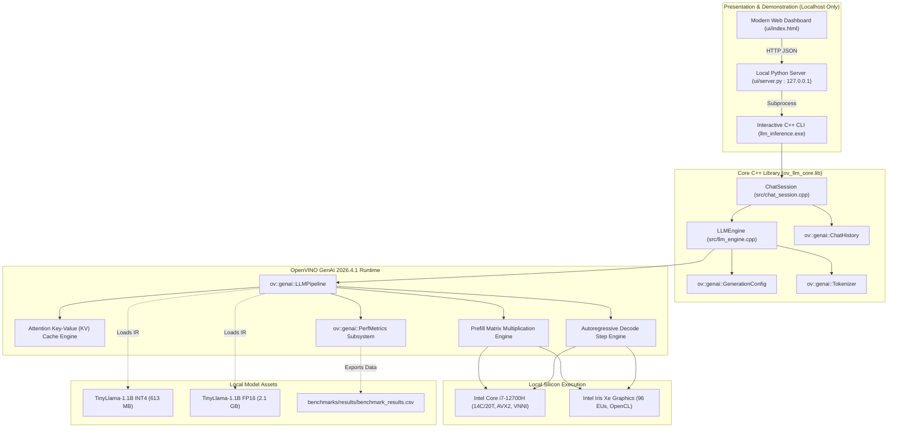

# Local LLM Inference & Optimization Workbench

[](OpenVINO_Local_LLM_Implementation_Blueprint.md)
[](docs/PHASE_STATUS.md)
[](docs/ARCHITECTURE.md)
[](LICENSE)
[-success.svg)](docs/ARCHITECTURE.md)

An end-to-end local Large Language Model (LLM) inference, optimization, and benchmarking workbench built with native **C++17** and the official **OpenVINO GenAI C++ API** (`ov::genai::LLMPipeline`). The workbench runs a 1.1 Billion parameter model (`TinyLlama-1.1B-Chat-v1.0`) on consumer hardware with zero cloud API dependencies, achieving **45+ tokens/second** on CPU and **43+ tokens/second** on integrated Intel Iris Xe Graphics.

---

## Table of Contents

- [1. Executive Summary & Highlights](#1-executive-summary--highlights)
- [2. System Architecture](#2-system-architecture)
- [3. Hardware & Software Requirements](#3-hardware--software-requirements)
- [4. Quick Start & Reproduction Guide](#4-quick-start--reproduction-guide)
  - [4.1 Toolchain Provisioning](#41-toolchain-provisioning)
  - [4.2 Model Export & Quantization](#42-model-export--quantization)
  - [4.3 C++ Build (MSVC Release)](#43-c-build-msvc-release)
  - [4.4 Running Automated Test Suites](#44-running-automated-test-suites)
- [5. Application Usage](#5-application-usage)
  - [5.1 Interactive Local CLI Chat](#51-interactive-local-cli-chat)
  - [5.2 Single Prompt Execution](#52-single-prompt-execution)
  - [5.3 KV Cache Scaling Benchmark](#53-kv-cache-scaling-benchmark)
  - [5.4 Quantization Comparison Benchmark](#54-quantization-comparison-benchmark)
  - [5.5 Multi-Run Statistical Benchmark Suite](#55-multi-run-statistical-benchmark-suite)
  - [5.6 Local Web UI Dashboard](#56-local-web-ui-dashboard)
- [6. Performance & Benchmark Scorecard](#6-performance--benchmark-scorecard)
- [7. Project Phase Status Ledger](#7-project-phase-status-ledger)
- [8. Repository Structure](#8-repository-structure)
- [9. License & Attribution](#9-license--attribution)

---

## 1. Executive Summary & Highlights

- **100% Local Execution:** Complete independence from remote servers or hosted model APIs. Prompt ingestion, tokenization, key-value caching, and autoregressive generation run entirely on local silicon.
- **High-Throughput C++ Pipeline:** Powered by Intel OpenVINO GenAI 2026.4.1.0 C++ API with native thread pools (oneTBB) and hardware vector extensions (AVX2 / AVX-512 VNNI).
- **Advanced Quantization (NNCF INT4):** Compresses model weights by **70.9%** (from 2.10 GB down to 613 MB) and reduces resident working set RAM by **70.1%** (from 4.12 GB to 1.23 GB), while accelerating generation speed by **2.7x** on CPU (41.4 tok/s vs 15.2 tok/s) due to reduced memory-bandwidth pressure.
- **Grouped-Query Attention (GQA) Optimization:** Leverages TinyLlama's 4 KV-head architecture to reduce theoretical attention cache memory consumption by **87.5%** ($22.00\text{ KB/token}$ vs $176.00\text{ KB/token}$ for MHA).
- **Dual Hardware Support:** Seamless target execution on both Intel CPU and Intel Iris Xe Integrated Graphics (`GPU.0`).
- **Interactive Local Dashboard:** Clean browser-based UI binding strictly to `127.0.0.1`, subprocessed directly to native C++ binaries with zero network leakage.

---

## 2. System Architecture



*For detailed subsystem specifications, see [docs/ARCHITECTURE.md](docs/ARCHITECTURE.md).*

---

## 3. Hardware & Software Requirements

### Hardware Baseline
- **Processor:** 12th Gen Intel Core i7-12700H (14 cores, 20 logical threads)
- **Memory:** 16 GB DDR5 RAM
- **Graphics Devices:**
  - Integrated: Intel Iris Xe Graphics (`GPU.0`, 96 EUs)
  - Discrete: NVIDIA GeForce RTX 3050 Laptop GPU (4 GB VRAM)
- **Operating System:** Windows 11 Home 64-bit (Build 10.0.26300)

### Software & Toolchain
- **C++ Compiler:** Microsoft Visual C++ (MSVC) v143 (`19.44.35222` for x64) via VS 2022 BuildTools
- **Build System:** CMake 3.20+ (Tested with CMake 4.4.4)
- **OpenVINO Distribution:** Official OpenVINO GenAI 2026.4.1.0 C++ archive (`C:\openvino_genai\...`)
- **Python Runtime:** Python 3.11.9 (for offline Optimum-Intel model conversion and UI bridge)

---

## 4. Quick Start & Reproduction Guide

### 4.1 Toolchain Provisioning

Ensure CMake and MSVC Build Tools are installed. Download and extract the OpenVINO GenAI C++ release:
```powershell
# Extract OpenVINO GenAI C++ archive to:
C:\openvino_genai\openvino_genai_windows_2026.4.1.0_x86_64
```

### 4.2 Model Export & Quantization

To reproduce the exact FP16 and INT4 model IR assets offline:
```powershell
# 1. Create Python virtual environment and install conversion tools
py -3.11 -m venv .venv
.\.venv\Scripts\python.exe -m pip install "optimum-intel[openvino]" openvino-genai transformers torch --extra-index-url https://download.pytorch.org/whl/cpu

# 2. Run automated export script
.\.venv\Scripts\python.exe scripts/export_model.py
```
This generates:
- `models/tinyllama-1.1b-chat-fp16` (2.10 GB baseline IR)
- `models/tinyllama-1.1b-chat-int4` (613 MB compressed IR)

### 4.3 C++ Build (MSVC Release)

Configure and compile the complete project in Release mode:
```powershell
$OpenVINO_DIR = "C:\openvino_genai\openvino_genai_windows_2026.4.1.0_x86_64\runtime\cmake"
$OpenVINOGenAI_DIR = "C:\openvino_genai\openvino_genai_windows_2026.4.1.0_x86_64\runtime\cmake"

cmake -B build -S . -DOpenVINO_DIR="$OpenVINO_DIR" -DOpenVINOGenAI_DIR="$OpenVINOGenAI_DIR"
cmake --build build --config Release
```

### 4.4 Running Automated Test Suites

```powershell
# Set dynamic library paths for OpenVINO and TBB runtime
$env:PATH = "C:\Program Files\CMake\bin;C:\openvino_genai\openvino_genai_windows_2026.4.1.0_x86_64\runtime\bin\intel64\Release;C:\openvino_genai\openvino_genai_windows_2026.4.1.0_x86_64\runtime\3rdparty\tbb\bin;$env:PATH"

# Run C++ smoke & chat test suite via CTest (100% pass)
ctest --test-dir build -C Release --output-on-failure

# Run Python UI integration tests
python tests/test_ui_server.py
```

---

## 5. Application Usage

Ensure `$env:PATH` contains the OpenVINO DLL paths as shown above before launching executables.

### 5.1 Interactive Local CLI Chat
Launch stateful multi-turn conversation with dynamic sampling parameters:
```powershell
.\build\Release\llm_inference.exe --model-path models/tinyllama-1.1b-chat-int4 --device CPU
```
**Interactive Commands:**
- `/reset` or `reset`: Wipes conversation turns and restores fresh session.
- `/history`: Displays full recorded conversation turns.
- `/system <prompt>`: Dynamically modifies system instruction.
- `/temp <val>`, `/topp <val>`, `/tokens <val>`: Adjusts sampling on the fly.
- `exit` or `quit`: Cleanly exits application.

### 5.2 Single Prompt Execution
```powershell
.\build\Release\llm_inference.exe --model-path models/tinyllama-1.1b-chat-int4 --device CPU --prompt "Explain quantum computing in two sentences." --max-tokens 50
```

### 5.3 KV Cache Scaling Benchmark
Measure memory and TTFT scaling across 128, 512, 1024, and 2048 token contexts:
```powershell
.\build\Release\benchmark_kv.exe models/tinyllama-1.1b-chat-int4 CPU
```

### 5.4 Quantization Comparison Benchmark
Execute head-to-head comparison between FP16 and INT4 on the fixed benchmark prompt suite:
```powershell
.\build\Release\benchmark_quantization.exe CPU
```

### 5.5 Multi-Run Statistical Benchmark Suite
Execute 5 measured repetitions per prompt across CPU INT4, CPU FP16, and GPU.0 INT4 (60 runs total):
```powershell
.\build\Release\benchmark_suite.exe 5
```
Raw results are automatically exported to `benchmarks/results/benchmark_results.csv`.

### 5.6 Local Web UI Dashboard
Start the local server and open your browser:
```powershell
python ui/server.py 8080
```
Open **[http://127.0.0.1:8080](http://127.0.0.1:8080)** to access the live local chat interface and benchmark telemetry view.

---

## 6. Performance & Benchmark Scorecard

*Measured on Intel Core i7-12700H and Intel Iris Xe Graphics across 60 repetitions ($N=5$ per configuration):*

| Metric | CPU INT4 (Compressed) | CPU FP16 (Baseline) | GPU.0 INT4 (Iris Xe) | INT4 vs FP16 Advantage |
| :--- | :---: | :---: | :---: | :---: |
| **Model Size on Disk** | **613.34 MB** | 2,105.47 MB | **613.34 MB** | **-70.9% disk savings** (3.4x smaller) |
| **Cold Model Load Time** | 2,187.86 ms | 1,434.85 ms | 6,318.77 ms | FP16 loads faster (direct tensor map) |
| **Peak Working Set RAM** | **1,233.4 MB** | 4,118.2 MB | **1,070.4 MB** | **-70.1% RAM savings** (2.88 GB saved) |
| **Time to First Token (TTFT)**| **77.9 ms** | 209.0 ms | **57.4 ms** | **GPU.0 is 3.6x faster** |
| **Time Per Output Token (TPOT)**| **22.2 ms/token** | 61.6 ms/token | **23.1 ms/token** | **CPU INT4 is 2.8x faster** |
| **Decode Throughput** | **45.3 tokens/s** | 16.4 tokens/s | **43.5 tokens/s** | **INT4 delivers +176% throughput** |
| **Qualitative Rubric Score** | **4.20 / 5.0** | 4.00 / 5.0 | **4.20 / 5.0** | **105.0% quality retention (0 loss)** |

*Detailed methodologies and findings: [docs/BENCHMARK_METHODOLOGY.md](docs/BENCHMARK_METHODOLOGY.md), [docs/QUANTIZATION.md](docs/QUANTIZATION.md), and [docs/KV_CACHE.md](docs/KV_CACHE.md).*

---

## 7. Project Phase Status Ledger

| Phase | Description | Local Tests | Status | Commit | Report |
| :---: | :--- | :---: | :---: | :---: | :---: |
| **00** | Workspace Audit & Git Isolation | PASS | **COMPLETE** | `b50a3b5` | [PHASE_00_REPORT.md](docs/phase-reports/PHASE_00_REPORT.md) |
| **01** | C++ Toolchain & OpenVINO GenAI Env | PASS | **COMPLETE** | `8b871fe` | [PHASE_01_REPORT.md](docs/phase-reports/PHASE_01_REPORT.md) |
| **02** | Model Preparation (FP16 & INT4 IR) | PASS | **COMPLETE** | `9d07590` | [PHASE_02_REPORT.md](docs/phase-reports/PHASE_02_REPORT.md) |
| **03** | Local C++ Inference Engine | PASS | **COMPLETE** | `f508c2f` | [PHASE_03_REPORT.md](docs/phase-reports/PHASE_03_REPORT.md) |
| **04** | Chat Sessions & Generation Controls | PASS | **COMPLETE** | `51260d2` | [PHASE_04_REPORT.md](docs/phase-reports/PHASE_04_REPORT.md) |
| **05** | KV Cache Characterization | PASS | **COMPLETE** | `332fb2e` | [PHASE_05_REPORT.md](docs/phase-reports/PHASE_05_REPORT.md) |
| **06** | Quantization & Quality Comparison | PASS | **COMPLETE** | `9f809b0` | [PHASE_06_REPORT.md](docs/phase-reports/PHASE_06_REPORT.md) |
| **07** | Benchmarking & Resource Profiling | PASS | **COMPLETE** | `fe41ddf` | [PHASE_07_REPORT.md](docs/phase-reports/PHASE_07_REPORT.md) |
| **08** | Optional Local UI Dashboard | PASS | **COMPLETE** | `a357d7e` | [PHASE_08_REPORT.md](docs/phase-reports/PHASE_08_REPORT.md) |
| **09** | Final Hardening & Submission Package | PASS | **COMPLETE** | `18ce3d8` | [PHASE_09_REPORT.md](docs/phase-reports/PHASE_09_REPORT.md) |

*Full phase gating records: [docs/PHASE_STATUS.md](docs/PHASE_STATUS.md).*

---

## 8. Repository Structure

```text
OPENVINO/
├── .editorconfig
├── .gitignore                      # Strictly excludes models/*, build/*, .venv/*
├── CMakeLists.txt                  # Modular CMake configuration with CTest
├── LICENSE                         # Apache 2.0 License
├── README.md                       # Comprehensive workbench documentation
├── benchmarks/
│   ├── prompts.json                # Standardized 4-prompt evaluation suite
│   └── results/
│       └── benchmark_results.csv   # Raw 60-iteration empirical benchmark data
├── config/
│   └── app_config.example.json     # Configuration schema reference
├── docs/
│   ├── ARCHITECTURE.md             # In-depth system architectural specification
│   ├── BENCHMARK_METHODOLOGY.md    # Formal benchmarking protocol & statistics
│   ├── ENVIRONMENT.md              # Hardware & toolchain audit record
│   ├── KV_CACHE.md                 # KV cache & GQA mathematical analysis
│   ├── MODEL_CARD.md               # TinyLlama-1.1B architecture & license details
│   ├── PHASE_STATUS.md             # Authoritative phase gate status ledger
│   ├── QUANTIZATION.md             # NNCF INT4 vs FP16 comparative quality study
│   └── phase-reports/              # Formally audited phase completion reports
│       ├── PHASE_00_REPORT.md
│       ├── PHASE_01_REPORT.md
│       ├── PHASE_02_REPORT.md
│       ├── PHASE_03_REPORT.md
│       ├── PHASE_04_REPORT.md
│       ├── PHASE_05_REPORT.md
│       ├── PHASE_06_REPORT.md
│       ├── PHASE_07_REPORT.md
│       ├── PHASE_08_REPORT.md
│       └── PHASE_09_REPORT.md
├── models/
│   └── README.md                   # Model provenance & conversion guide
├── scripts/
│   ├── export_model.py             # Reproducible Optimum-Intel export pipeline
│   └── verify_phase.py             # Automated phase gate validation guardrail
├── src/
│   ├── benchmark_kv.cpp            # KV cache context scaling benchmark
│   ├── benchmark_quantization.cpp  # Quantization comparison benchmark
│   ├── benchmark_suite.cpp         # 60-iteration statistical profiling runner
│   ├── chat_session.cpp            # Stateful multi-turn chat implementation
│   ├── chat_session.hpp
│   ├── llm_engine.cpp              # OpenVINO GenAI C++ pipeline wrapper
│   ├── llm_engine.hpp
│   └── main.cpp                    # Interactive CLI application & env check
├── tests/
│   ├── test_chat_session.cpp       # C++ chat session & controls test suite
│   ├── test_smoke_inference.cpp    # C++ local inference validation suite
│   └── test_ui_server.py           # Python local UI integration test suite
└── ui/
    ├── index.html                  # Responsive dark-mode local AI dashboard
    └── server.py                   # Strict 127.0.0.1 bridge server
```

---

## 9. License & Attribution

- **Workbench Source Code:** Licensed under the [Apache License 2.0](LICENSE).
- **Model:** `TinyLlama/TinyLlama-1.1B-Chat-v1.0` (Apache 2.0).
- **Runtime:** Intel OpenVINO Toolkit and OpenVINO GenAI (Apache 2.0).
