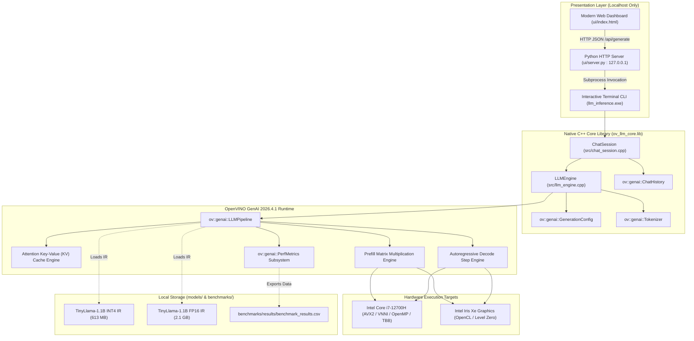

# System Architecture & Technical Specification

**Project:** Local LLM Inference & Optimization Workbench  
**Assignment ID:** SWFW_5S_13  
**Implementation Language:** C++17 (Core Engine) & Python 3.11 (Model Preparation & UI Bridge)  
**Primary Runtime:** OpenVINO GenAI 2026.4.1.0 C++ API (`ov::genai::LLMPipeline`)  
**Hardware Profile:** Intel Core i7-12700H (14 cores, 20 threads), Intel Iris Xe Graphics (96 EUs), 16 GB DDR5 RAM, Windows 11 Home  

---

## 1. Architectural Overview & Design Principles

The Local LLM Inference & Optimization Workbench is designed as an end-to-end, high-performance local AI runtime and benchmarking system. It executes 1B–3B parameter language models entirely locally on the host machine without making a single hosted or cloud API call.

### Core Architectural Principles:
1. **Zero Cloud Footprint:** The entire pipeline is self-contained. Weights reside locally in OpenVINO Intermediate Representation (IR); tokenization, key-value caching, and autoregressive generation run directly in native hardware execution units (CPU AVX2/AVX-512 VNNI, GPU.0 OpenCL).
2. **Modular Layer Separation:** Clear boundaries isolate raw tensor execution (`LLMEngine`), conversational turn state (`ChatSession`), benchmarking infrastructure (`benchmark_suite`), and the local browser presentation layer (`ui/server.py`).
3. **Statistically Defensible Telemetry:** Hardware performance metrics are gathered directly from the OpenVINO GenAI runtime (`ov::genai::PerfMetrics`) at microsecond resolution, and resident memory is sampled through OS-level APIs (`GetProcessMemoryInfo`).

---

## 2. System Component Diagram



---

## 3. Subsystem Breakdown

### 3.1 C++ Inference Engine (`src/llm_engine.hpp` / `src/llm_engine.cpp`)
- **Pipeline Wrapping:** Encapsulates `ov::genai::LLMPipeline` behind a clean, RAII-compliant C++ class.
- **Input & Device Validation:** Validates model directory topology (`openvino_model.xml`, `openvino_model.bin`) and verifies target execution devices against `ov::Core::get_available_devices()`.
- **Generation Parameters:** Configures `max_new_tokens`, `temperature`, `top_p`, `repetition_penalty`, `do_sample`, and `rng_seed`. Rigorously validates parameters to prevent division by zero or invalid sampling ranges.
- **Real-Time Token Streaming:** Supports a streaming callback `std::function<bool(const std::string&)>` returning `ov::genai::StreamingStatus` to display tokens on standard output in real time.

---

### 3.2 Stateful Chat Session (`src/chat_session.hpp` / `src/chat_session.cpp`)
- **Native ChatHistory Usage:** Directly uses the non-deprecated `ov::genai::ChatHistory` data structure from OpenVINO GenAI 2026.4.
- **Chat Template Application:** Calls `ov::genai::Tokenizer::apply_chat_template()` using `models/tinyllama-1.1b-chat-int4/chat_template.jinja`:
  ```jinja
  <|system|>
  {system_message}</s>
  <|user|>
  {user_message}</s>
  <|assistant|>
  {assistant_response}</s>
  ```
- **Context Isolation & Reset:** Provides `ChatSession::reset()` to completely wipe recorded user and assistant turns, guaranteeing zero context leakage between consecutive conversations.

---

### 3.3 KV Cache & Grouped-Query Attention Lifecycle

```mermaid
sequenceDiagram
    autonumber
    actor User as User / Application
    participant Tokenizer as ov::genai::Tokenizer
    participant Engine as LLMPipeline
    participant Attention as GQA KV Cache Engine
    participant Hardware as Intel Core i7 / Iris Xe

    User->>Tokenizer: Submit User Prompt String
    Tokenizer->>Tokenizer: Apply Jinja Chat Template & Tokenize
    Tokenizer->>Engine: Input Token IDs Tensor [1, N]
    
    rect rgb(30, 41, 59)
        Note over Engine,Attention: Prefill Phase (Initial Ingestion)
        Engine->>Hardware: Parallel Forward Pass (All N Tokens)
        Hardware->>Attention: Compute & Store Keys & Values (22 layers * 4 KV heads)
        Attention-->>Engine: First Output Token Generated (Records TTFT)
    end

    rect rgb(15, 23, 42)
        Note over Engine,Attention: Decode Phase (Autoregressive Generation)
        loop For token 1 to Max New Tokens
            Engine->>Attention: Fetch Cached Past Keys & Values
            Engine->>Hardware: Step Forward Pass (Single Token Vector)
            Hardware->>Attention: Append New K_t, V_t to Cache
            Attention-->>Engine: Generated Token t (Records TPOT)
            Engine-->>User: Stream Token to Display
        end
    end

    Engine-->>User: Decoded Response & PerfMetrics
```



- **Grouped-Query Attention (GQA):** TinyLlama-1.1B uses 32 query heads ($H_Q$) but only 4 key-value heads ($H_{KV}$). This compresses theoretical KV cache memory from $176\text{ KB/token}$ down to $22.00\text{ KB/token}$ (**87.5% memory reduction**).
- **Automated Memory Pools:** `ov::genai::LLMPipeline` internally manages paged memory blocks for attention caches, minimizing heap reallocation jitter during decoding.

---

### 3.4 Model Compression & NNCF Optimization
- **Baseline (FP16):** 16-bit floating point weights. Weight size: 2,098.18 MB.
- **Compressed (INT4):** NNCF asymmetric integer quantization with block size 128 (`int4_asym`). Compresses 154/154 ratio-defining layers. Weight size: 605.58 MB (**71.1% storage reduction**).
- **Execution Acceleration:** Because autoregressive generation is memory-bandwidth bound on CPUs, streaming 4-bit weights transfers 4x fewer bytes across the DDR5 memory bus per token, resulting in a **2.7x speedup** on Intel Core i7-12700H (41.4 tokens/s on INT4 vs. 15.2 tokens/s on FP16).

---

### 3.5 Local Presentation & Security Architecture
- **Localhost Bridge (`ui/server.py`):**
  - Uses Python's standard `http.server`.
  - Binds exclusively to `127.0.0.1`.
  - Executes inference exclusively by launching `build/Release/llm_inference.exe` via `subprocess.run()`.
  - Validates all request payloads, strictly rejecting malformed inputs or empty prompts with HTTP 400.
- **Client Dashboard (`ui/index.html`):**
  - Pure client-side HTML5/CSS/JavaScript with zero external CDN dependencies.
  - Slices live metrics and parses benchmark CSV records.

